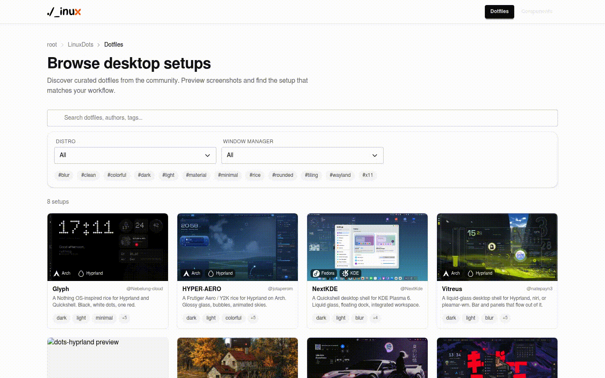
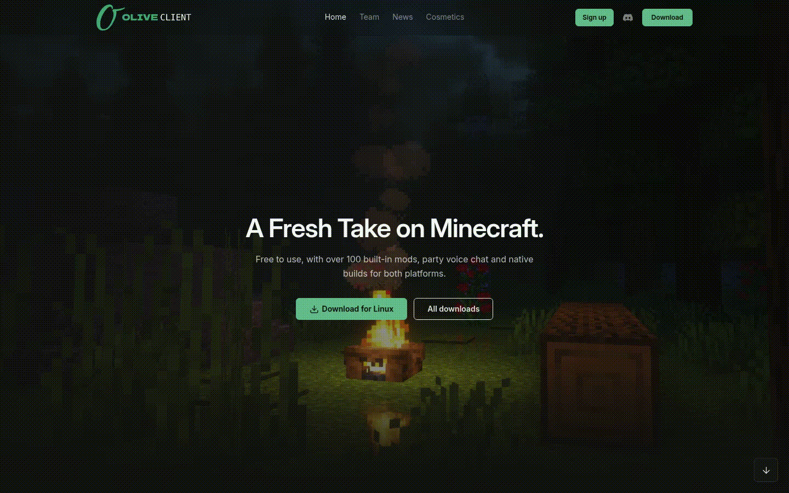

# Tyler

Software developer and tech enthusiast. Co-founder of [Olive Interactive](https://github.com/OliveInteractive).

---

### Projects

<table>
<tr>
<td width="50%" valign="top">

<b>linuxdots</b> Contributor, open source

A gallery of Linux dot files (rices).

<a href="https://github.com/RealVerbs/linuxdots">Source on GitHub</a>

</td>
<td width="50%" valign="top">

<b>Olive Client</b> Co-founder, Olive Interactive

A free Minecraft PvP client for 1.8.9 and newer, with 100+ built-in mods, party voice chat, and native builds for Windows and Linux.

<a href="https://oliveclient.pages.dev">oliveclient.pages.dev</a>

</td>
</tr>
</table>

<!--
Hey! My discord is reallytyler
-->
